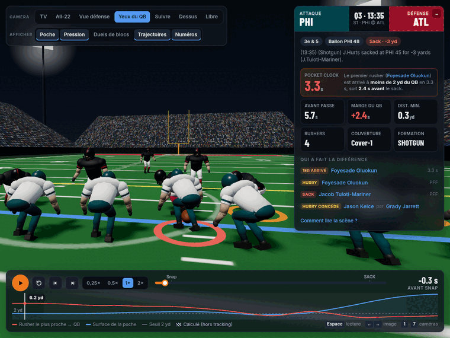
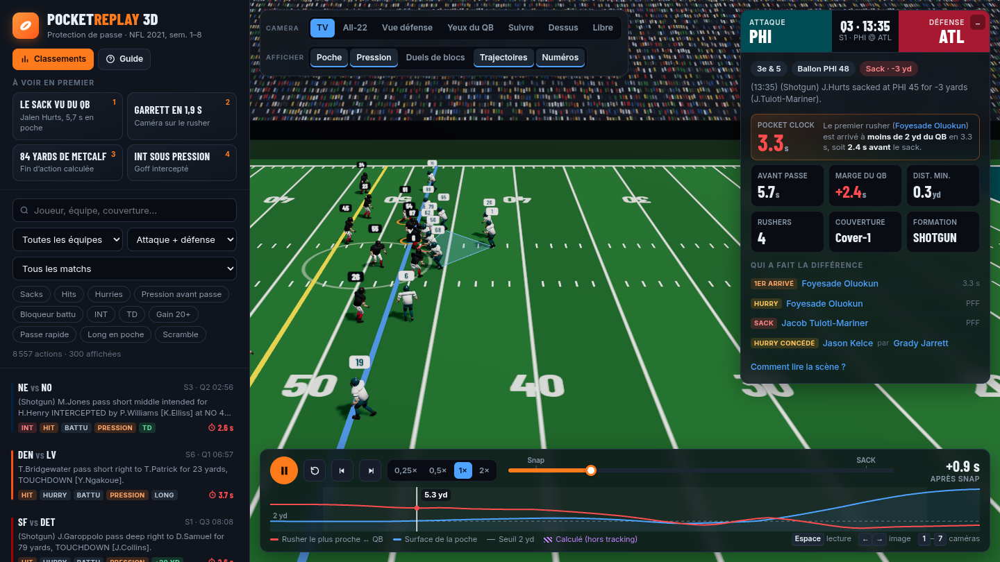
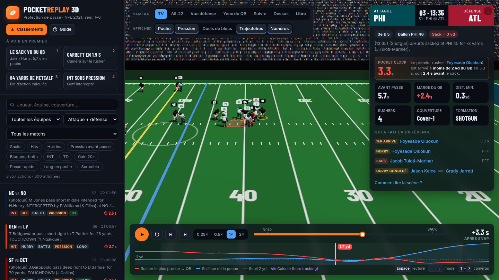

# PocketReplay 3D: the Pocket Clock

### 👉 [**Open the live demo**](https://molinaalexandre.github.io/NFLDAYS/), no install, runs in the browser



**In short.** We built a 3D replay tool that rebuilds every NFL dropback from weeks 1–8 of the 2021 season (8,557 plays, 8.3 M tracking rows) from Next Gen Stats tracking. You can scrub through any play like a video and watch it from any angle: TV, All-22, the defense's view, or **through the quarterback's own facemask**. On top of it we introduce the **Pocket Clock**, the time from the snap until the first pass rusher gets within 2 yards of the QB. It shows what the box score hides: sacks happen on only **6 %** of dropbacks, but a rusher is in the QB's face before the throw on **32 %** of them, and the Pocket Clock tells you who got there, how fast, and which blocker gave way. An offensive line coach can grade protection snap by snap with it, a scout can rank pass rushers by how fast they reach the QB instead of by sack totals, and a broadcaster can replay a sack from the quarterback's point of view.

---

## Why it matters

A sack is the visible end of a protection failure, but most failures never become sacks. The QB throws early, throws it away, or gets hit as he releases. On film you only see those **2 to 3 seconds** if you rewind the All-22 again and again, from one fixed angle.

The numbers show how tight that window is. When pressure arrives, it arrives after a **median of 2.7 s**, and the median QB releases the ball after **2.8 s**. Pass protection is decided in that tenth of a second, and that is what PocketReplay lets you see and measure.

## The Pocket Clock

| | |
|---|---|
| **Definition** | Time between the snap and the first frame where a pass rusher (PFF role) is within **2 yards** of the passer, using the 10 Hz tracking. It only counts if it happens **before the release** (or the sack / scramble). |
| **Clean pocket** | No rusher ever got within 2 yd before the throw. |
| **QB margin** | Time to throw − Pocket Clock: how long the QB stood in pressure before getting rid of the ball. |
| **Context per play** | Time to throw, closest rusher distance, number of rushers (5+ = blitz), coverage (Cover-1, Cover-3…), formation, PFF hits / hurries / sacks, and *which blocker was beaten by whom*. |

## What it reveals

**Validated against human charting.** The Pocket Clock is computed purely from tracking, yet **81 %** of the plays it flags as pressured were also charted as a hurry, hit or sack by PFF's analysts. It also catches **97 %** of all sacks. It is an automatic and reproducible stand-in for hours of manual charting, and it adds the *time* dimension that the charting does not have.

We did not tune anything to get these results, and the rankings match what anyone who watched the 2021 season would expect:

| Most often first to the QB (wk 1–8) | Pressures | Median Pocket Clock |
|---|---|---|
| Trey Hendrickson (CIN) | 44 | 2.7 s |
| Myles Garrett (CLE) | 41 | 2.5 s |
| Yannick Ngakoue (LV) | 38 | 2.4 s |
| Matt Judon (NE) | 33 | 2.9 s |

| Best pass protection | Pressure rate | | Worst | Pressure rate |
|---|---|---|---|---|
| **LA Rams** (Stafford) | 17.5 % | | IND | 38.8 % |
| **Tampa Bay** (Brady) | 19.4 % | | DEN | 39.0 % |

The two cleanest pockets in the league belonged to the Rams, who won the Super Bowl that season, and Tom Brady's Buccaneers. The worst offense in our sample put its QB under pressure more than twice as often.



## Try it in 30 seconds

1. [**The sack through the QB's eyes**](https://molinaalexandre.github.io/NFLDAYS/#g=2021091200&p=2631&cam=qb): Jalen Hurts holds it 5.7 s, the pocket turns red at 3.3 s, then the sack.
2. [**Myles Garrett gets home in 1.9 s**](https://molinaalexandre.github.io/NFLDAYS/#g=2021102100&p=2798&cam=endzone): watch the edge from the defense's view.
3. [**DK Metcalf, 84-yard touchdown**](https://molinaalexandre.github.io/NFLDAYS/#g=2021102500&p=326&cam=broadcast): a clean pocket, then the rest of the play rebuilt beyond the tracking.
4. [**The rankings**](https://molinaalexandre.github.io/NFLDAYS/#g=2021091200&p=2631&open=leaders): click any name to list that player's plays.

Inside the tool you can filter 8,557 plays by team, player, coverage or event (sacks, hits, hurries, beaten blocker, blitz…). Click a player to follow him, and use the timeline to step frame by frame. Keys: `Space` plays or pauses, `←` / `→` step one frame, `1`–`7` switch cameras.



## Who would use it

- **Offensive line coach.** Which lineman gave way, against whom, after how long, and on which blitz or stunt. Reviewed in 3D instead of rewinding tape.
- **Scout / recruiter.** Rank pass rushers by *how often and how fast* they reach the QB. That signal is steadier than sack totals, which depend on the QB and on luck.
- **Commentator / broadcaster.** Replay a sack from the quarterback's point of view, with the Pocket Clock on screen, to explain *why* the play broke down.

## How it works

- **`app/pipeline.py` (Python, pandas).** Joins tracking, plays and PFF scouting. For each of the 8,557 dropbacks it computes the Pocket Clock, the pocket area (convex hull of the blockers and the QB), the closest rusher distance and the tags, then aggregates the rankings. It exports compact gzipped JSON (71 MB for the whole dataset).
- **`app/web/` (Three.js, WebGL).** A static site with no build step. It interpolates the 10 Hz tracking to 60 fps and offers 7 camera rigs that follow the ball. It overlays the pocket (red under 2 yd), lines from each rusher closing on the QB, the PFF blocking matchups and a live pressure chart.
- **Animated players.** A low-poly model made in Blender, with the real 2021 home and away uniforms of all 32 teams. Strides are driven by the actual distance covered in the tracking, poses depend on each player's PFF role, and the QB holds the ball, cocks his arm and throws on the real release frame.
- **Rest of the play, rebuilt.** The tracking stops 0.5 s after the throw. We rebuild the rest of the play from the play description, the measured ball speed, the receiver's last measured velocity and the official yardage, which also gives estimated air yards and YAC. This part is **always flagged in purple** in the UI (hatched timeline, translucent players, dashed paths) so it is never mistaken for real data.

## Honest limits

- The dataset only contains dropbacks, so there are no runs and no special teams. It also stops 0.5 s after the release, which is why the end of the play is computed and flagged.
- The 2-yard threshold is a modelling choice. It finds 69 % of the pressures charted by PFF; the rest are mostly QBs who escape before a rusher closes to 2 yd.
- The tracking has no height for the ball, so the ball's arc is a parabola.

## Team

**Abdallah Hammad**, **Alexandre Molina**. Built during the Big Data Bowl NY Regional side quest.

## Run locally

```bash
git clone https://github.com/ThompsonJamesBliss/nfl-big-data-bowl-regional-event-data
cd app && uv run --with pandas --with numpy python pipeline.py   # ~10 min, writes web/data/
cd web && python3 -m http.server 8765                              # http://localhost:8765
```

Technical details: [`app/README.md`](app/README.md).

---

## 🇫🇷 Version française

**En bref.** Nous avons construit un outil de replay 3D qui recrée chaque dropback des semaines 1 à 8 de la saison NFL 2021 (8 557 actions, 8,3 M de lignes de tracking). On peut faire défiler n'importe quelle action comme une vidéo et la regarder sous n'importe quel angle : TV, All-22, vue de la défense ou **à travers la grille du casque du quarterback**. Par-dessus, nous introduisons le **Pocket Clock** : le temps entre le snap et le moment où le premier pass rusher arrive à moins de 2 yards du QB. Il montre ce que les statistiques classiques cachent : les sacks n'arrivent que sur **6 %** des dropbacks, mais un rusher est sur le QB avant la passe dans **32 %** des cas. Le Pocket Clock dit qui est arrivé, en combien de temps, et quel bloqueur a cédé. Un coach de ligne offensive peut s'en servir pour noter la protection action par action, un recruteur pour classer les pass rushers par vitesse d'arrivée sur le QB plutôt qu'au nombre de sacks, et un commentateur pour rejouer un sack du point de vue du quarterback.

**Validé contre le travail des analystes.** 81 % des pressions détectées par le Pocket Clock sont aussi notées par les analystes de PFF (hurry, hit ou sack), et il détecte 97 % des sacks, automatiquement et avec la dimension *temps* en plus.

**Pourquoi c'est pertinent.** Quand la pression arrive, c'est après **2,7 s** en médiane, et le QB médian lâche le ballon après **2,8 s**. La protection de passe se joue sur ce dixième de seconde. Sans retouche de notre part, les classements retrouvent la réalité de 2021 : Hendrickson, Garrett, Ngakoue et Judon arrivent le plus souvent en premier sur le QB, et les deux meilleures protections sont les **Rams** (champions cette saison-là) et les **Buccaneers** de Brady.

**Honnêteté.** Le tracking s'arrête 0,5 s après la passe. La suite de l'action est reconstruite (description, vitesse mesurée du ballon, yards officiels) et **toujours signalée en violet** dans l'interface.

👉 **Démo : https://molinaalexandre.github.io/NFLDAYS/**
